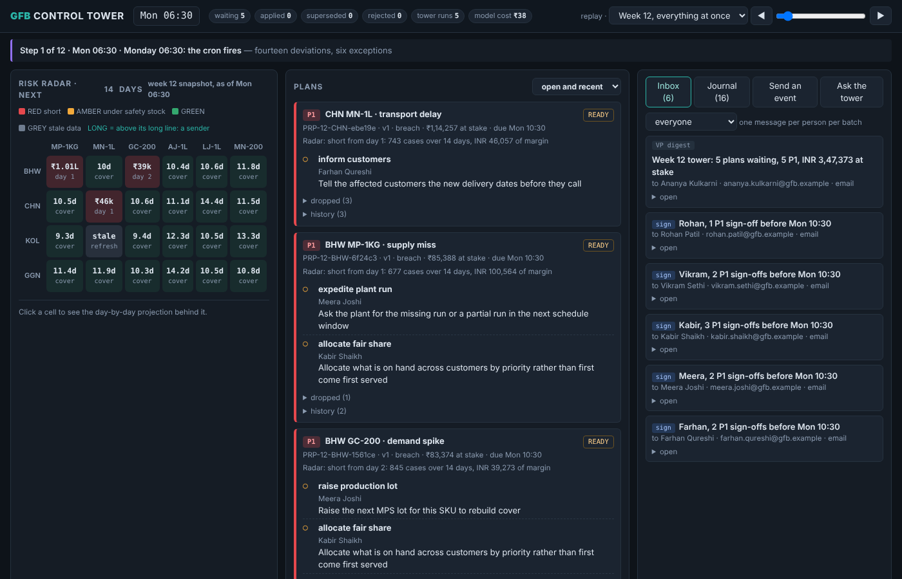
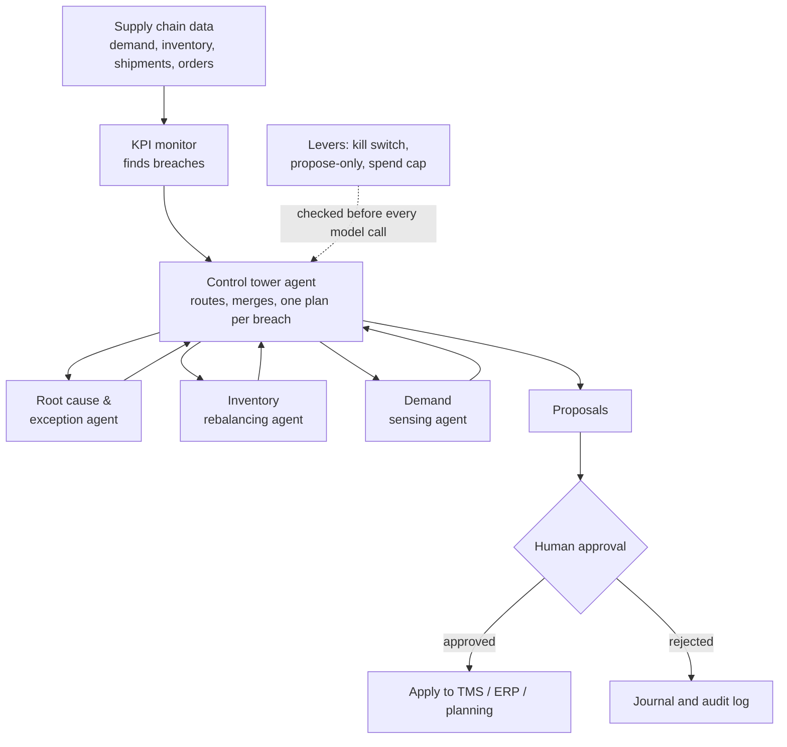

# GFB Foundry: an agentic AI supply chain control tower

[](https://github.com/ismraviranjan-netizen/gfb-foundry/actions/workflows/evals.yml)


Three specialist AI agents (root cause, inventory rebalancing, demand sensing) work under one
control tower agent. The tower turns a supply chain breach into a single plan, with a named human
approver for every action. It runs on Claude through Amazon Bedrock.

Everything runs on a synthetic company, Gokul Foods & Beverages (GFB): six sites, ten SKUs, twelve
lanes. No real client and no real data.



## At a glance

| | |
|---|---|
| Agents | Root cause & exception management, inventory rebalancing, demand sensing, plus a control tower that routes and merges their findings |
| Model | Claude on Amazon Bedrock (Converse API), with a scripted "fake brain" so tests and evals run offline at no cost |
| Tests | 354 automated tests |
| Evals | 8 labelled eval sets, each gated at 90% in CI: no eval, no deploy |
| Guardrails | Kill switch, propose-only mode, per-tool disable, human approval before any action, spend budget per run |
| Deploy | Optional AWS deployment (see Deploy to AWS below); runs only after a human approves |

## How it works



The design rule throughout: **maths decides, the model explains and chooses.** Costs, cover days
and transfer economics are computed in plain Python. The model picks between options that the maths
has already priced, and explains the choice in language a planner can check.

## Run it yourself

No AWS account is needed for the default (scripted) mode.

```bash
pip install pyyaml pytest
make test          # the full test suite
make evals         # every eval set, each gated at 90%
```

Try the agents from the command line:

```bash
python3 -m foundry.cli monitor --week 12                              # find this week's breaches
python3 -m foundry.cli diagnose --dc CHN --sku MN-1L --week 12        # root cause agent
python3 -m foundry.cli rebalance --sku MN-1L --week 1 --position      # rebalancing agent
python3 -m foundry.cli sense --dc CHN --sku MN-1L --origin-week 16    # demand sensing agent
python3 -m foundry.cli plan --dc CHN --sku MN-1L --week 12            # the control tower
```

Open the console shown above:

```bash
python3 -m foundry.console.server --storyline blank    # http://localhost:8080, then press Run Monday
```

Add `--live` to any agent command to use Claude on Bedrock instead of the scripted brain
(`aws login --region ap-south-1`; set `FOUNDRY_MODEL` to choose the model).

## The agents

| Agent | Module | Eval cases | What it proposes |
|---|---|---|---|
| Root cause & exception management | `foundry/agents/rca_exception/` | 30 | A cause with evidence, the money at stake, a priority with an SLA, and a playbook with named approvers |
| Inventory rebalancing | `foundry/agents/rebalancing/` | 20 | A priced transfer between distribution centres, or the reason none pays |
| Demand sensing | `foundry/agents/sensing/` | 24 | A short-horizon forecast adjustment, or silence with the back-test that says why |
| Exception queue | `foundry/agents/rca_exception/queue*.py` | 12 | The week's queue with SLA clocks, reminders, escalations and a digest |
| Control tower | `foundry/tower/` | 14 | One plan per breach from the specialists' findings, one approver per action |

Supporting pieces: a 14-day risk radar (`foundry/risk`), an event-driven orchestrator
(`foundry/orchestrator`), a read-only chat agent with a guarded text-to-SQL helper (`foundry/chat`,
`foundry/sqlx`), and a supply chain carbon accounting agent (`foundry/carbon`).

## Guardrails

- **Kill switch, propose-only and per-tool disable** (`foundry/levers.py`), checked before every model call. Backed by a file locally or DynamoDB on AWS.
- **Human approval** (`foundry/approval.py`): agents only propose. Nothing is applied until a named person approves it.
- **Budget and stop conditions** (`foundry/loop.py`): every agent run has a spend budget, a step cap and six defined ways to stop.
- **Least privilege**: each agent gets only its own tools.
- **Cost ledger** (`ops/ledger.py`): cost per run, p95 latency and stop reasons.

## One codebase, many companies

The core never reads a company name. Structure comes from a network file (`networks/*.yaml`) and
every company-specific number and name from a profile (`profiles/*.yaml`). Profiles are included for
a brewer, a pharma company, a retailer and a bakery, with industry plug-ins in `foundry/plugin_lib/`.

```bash
python3 -m foundry.cli --profile brewer plan --dc CHN --sku MN-1L --week 1 --position
```

The `kit/` folder holds the onboarding method for a new company: discovery questions, a one-page
canvas, a data-mapping sheet and a pilot plan.

## Deploy to AWS

```bash
make layer && cd deploy && terraform init && terraform apply -var fake=1   # scripted smoke test
terraform apply -var fake=0                                               # live model
```

Routes: `POST /diagnose /sweep /rebalance /sense /queue /plan` and `GET /health`.
The GitHub Actions deploy workflow runs every eval set first, then applies only after a reviewer
approves the `production` environment. It uses an OIDC role, so there are no long-lived AWS keys.

## Repository layout

```
foundry/            core loop, levers, approval, Bedrock client, agents, tower, console
evals/              labelled eval sets and their runners (each one a CI gate)
tests/              the test suite
deploy/             AWS deployment files
ops/                cost and latency ledger
profiles/ networks/ company profiles and network definitions
kit/                onboarding kit for a new company
labs/               decision-science labs (quantiles, newsvendor, back-testing, and more)
capstone/           a second synthetic company's data pack for onboarding practice
```

## Author

Built by [Ravi Ranjan](https://github.com/ismraviranjan-netizen). MIT licensed.
